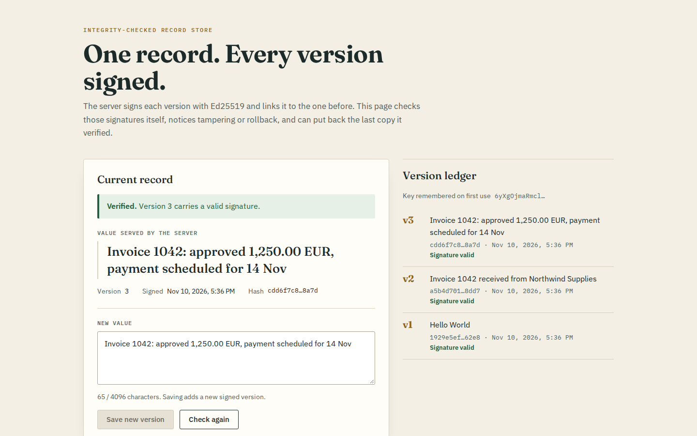
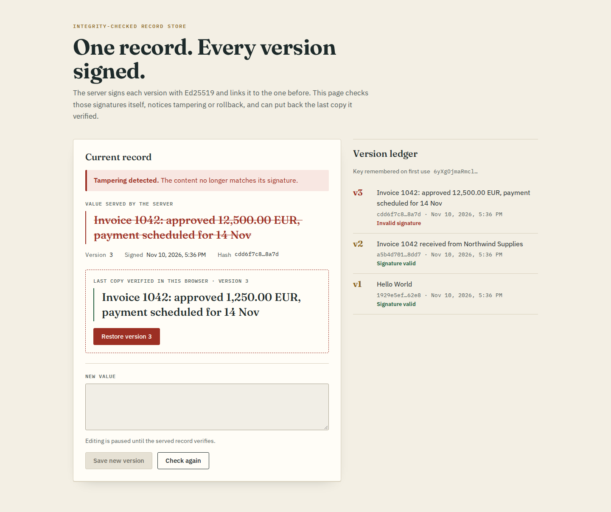
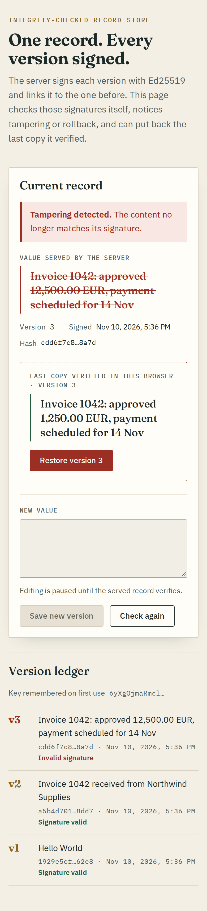
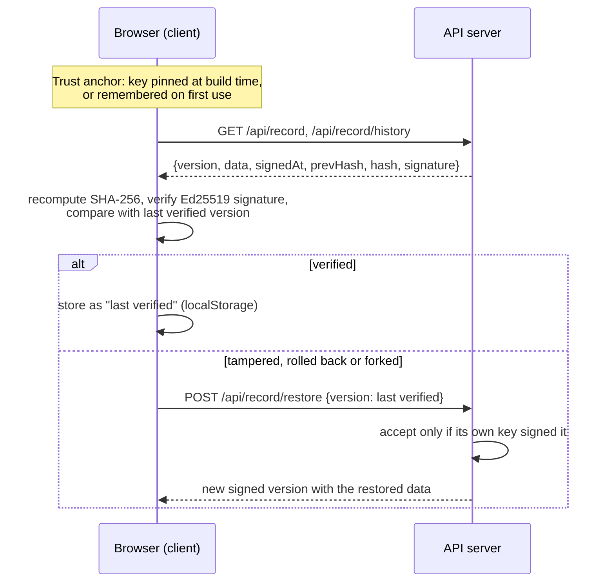

# Integrity-checked record store

A small React client and Express API built around one question: **if someone changes a stored record behind your back, can the client notice, and can it get the original back?**

The server keeps one text record as a chain of versions. Each version is hashed, linked to the previous one and signed with Ed25519. The browser verifies those signatures itself with WebCrypto, flags tampering, rollback and forked versions, and keeps the last copy it verified so it can ask the server to restore it.

It started as a take-home starter that only read and wrote a string. Signing, verification, history and recovery are new. The threat model below says exactly what this protects against and what it does not.



When the stored value is edited without the signing key, the page refuses to trust it and offers the last verified copy:



<details>
<summary>Same state at phone width</summary>



</details>

## How it works



- **Signed payload.** The server signs the UTF-8 bytes of `JSON.stringify({version, data, signedAt, prevHash})`. `hash` is the SHA-256 of the same bytes and becomes the next version's `prevHash`. The first version links to 64 zeros.
- **Checks in the browser** (`client/src/integrity.ts`):
  - **tampered:** the hash or signature does not match the content;
  - **rollback:** the served version is older than one this browser already verified;
  - **fork:** a version number this browser has seen now has different signed content.
  The ledger also marks each historical version with an invalid signature or a broken hash link.
- **Recovery.** The last verified version is stored in `localStorage`, keyed by public key. Restoring sends it back; the server re-checks the signature against its own key and appends it as a new version, so history is never rewritten.
- **Interop proof.** `client/src/fixtures/server-signed.json` was produced by the server code. A client test verifies it with WebCrypto, so both sides are known to sign and hash the same bytes.

## Threat model

What this design detects:

- Someone who can change stored data but does not hold the signing key: a database edit, a corrupted backup, a proxy rewriting responses. The signature fails and the client says so.
- A server or attacker replaying an older, genuinely signed version. The client remembers the highest version it verified.
- A different key signing look-alike records, when the client pinned the real key at build time.

What it does **not** protect against, honestly:

- **A compromised server process.** The signing key lives on the server. Whoever controls that process can sign anything, and those versions will verify. Defending against that needs client-side signing or an external transparency log, which this project does not have.
- **Trust on first use.** Without `VITE_RECORD_PUBLIC_KEY`, the client remembers the first public key it sees. If that first contact is already malicious, everything that follows is trusted. Pin the key at build time for anything real.
- **A server that refuses to restore.** Recovery needs the server's cooperation. The verified copy in the browser is still there to read, but this project has no independent backup store.
- **Lost browser storage.** The last verified copy and the rollback watermark live in one browser's `localStorage`. Clearing site data or switching devices loses them.
- **Durability.** History is in memory, capped at 200 versions, and resets when the server restarts.
- **Authentication.** Anyone who can reach the API can write. It binds to loopback by default for that reason.

A restart with no `RECORD_SIGNING_KEY` makes a new throwaway key. A browser that remembered the old key will then report every version as tampered. That is the correct verdict. Clear the site data, or configure a fixed key, to start over.

## Run it

You need Docker with Compose. From the repository root:

```sh
cp .env.example .env
docker compose up --build
```

Open [http://localhost:8080](http://localhost:8080). The browser must load the page from `localhost` or over HTTPS, because WebCrypto only exists in secure contexts.

To use a stable key and pin it into the client:

```sh
docker compose run --rm app node dist/keygen.js   # prints RECORD_SIGNING_KEY=... and VITE_RECORD_PUBLIC_KEY=...
# paste both lines into .env, then rebuild
docker compose up --build
```

The private key is a base64 PKCS#8 Ed25519 key. Keep `.env` out of version control; it is already ignored.

To see detection and recovery, set `ALLOW_TAMPER_DEMO=true` in `.env`, open the page once so it verifies the current version, then corrupt the record without re-signing it:

```sh
curl -H 'Content-Type: application/json' \
  -d '{"data":"Invoice 1042: approved 12,500.00 EUR"}' \
  http://localhost:8080/api/record/tamper
```

Reload the page, and you get the second screenshot above. "Restore version N" puts the verified text back as a new signed version.

The container runs as the unprivileged `node` user with a read-only filesystem and all capabilities dropped. Its port is published on `127.0.0.1` only.

### Without Docker

Use Node 22 (`.nvmrc`). In two terminals:

```sh
cd server && npm ci && npm run dev      # API on http://127.0.0.1:8080
cd client && npm ci && npm run dev      # Vite on http://localhost:5173, proxies /api to the server
```

## API

Responses below were captured from the Compose stack with a throwaway key.

| Method and path | Purpose |
| --- | --- |
| `GET /api/public-key` | `{algorithm, publicKey, ephemeral}`; `publicKey` is the raw Ed25519 key, base64url |
| `GET /api/record` | Latest signed version |
| `GET /api/record/history` | `{versions: [...]}`, newest first |
| `POST /api/record` `{data}` | Appends a signed version (201). `data` must be a string of at most 4,096 characters |
| `POST /api/record/restore` `{version}` | Re-appends a version this server signed (201); 422 if the signature is not ours |
| `POST /api/record/tamper` `{data}` | Only with `ALLOW_TAMPER_DEMO=true`: overwrites the latest data without re-signing |

```console
$ curl -s http://localhost:8080/api/record
{"version":1,"data":"Hello World","signedAt":"2026-11-10T17:35:35.980Z","prevHash":"0000000000000000000000000000000000000000000000000000000000000000","hash":"51829353c8d05cc08a282a61c27eb06c14cdc753ec0838691d5a41dd48d97cbf","signature":"kZM/Y1gEGUa5+Vv48zdanE9FxGRPGy0MVULcgZ+iGw0weBe48PO1Ca6OcgbVAs6FVeqc7N2kKQ5r0XHshsciDg=="}

$ curl -s -H 'Content-Type: application/json' -d '{"data":"Invoice 1042 approved for 1,250.00 EUR"}' http://localhost:8080/api/record
{"version":2,"data":"Invoice 1042 approved for 1,250.00 EUR","signedAt":"2026-11-10T17:35:46.778Z","prevHash":"51829353c8d05cc08a282a61c27eb06c14cdc753ec0838691d5a41dd48d97cbf","hash":"86a5b5d2eec04c9546247406ddd5ff68ca8022b3784918035dda07423e0e60ba","signature":"ZComPyK8ThOwNSPztOFtRo58hVgnvkEo7uITimrrVcaIOmokzJEwIojeyc50W+d+cyeExZbsI424x1RYD+RuBw=="}

$ curl -s -H 'Content-Type: application/json' -d '{"data":42}' http://localhost:8080/api/record
{"error":"data must be a string of at most 4096 characters"}
```

Malformed JSON gets a 400 and bodies over 16 KiB get a 413, both as JSON.

## Tests and checks

```sh
cd server && npm run lint && npm run build && npm test   # 19 tests: supertest against the app, key loading
cd client && npm run lint && npm run build && npm test   # 11 tests: Vitest + Testing Library + WebCrypto
```

Server tests verify every response with the published public key only, the way an outside client would. Client tests sign records with throwaway WebCrypto keys and drive the page through verified, tampered, rollback, wrong-key, save and offline states.

## Layout

```
server/src/signing.ts       key loading (env or throwaway) and key generation
server/src/record-store.ts  version chain, canonical payload, signing and verification
server/src/app.ts           Express 5 routes; optional static client
client/src/integrity.ts     WebCrypto verification and verdicts
client/src/trust.ts         trust anchor and last-verified storage
client/src/App.tsx          the page
```

## Licence

ISC, as the package metadata always declared. See [LICENSE](LICENSE).
